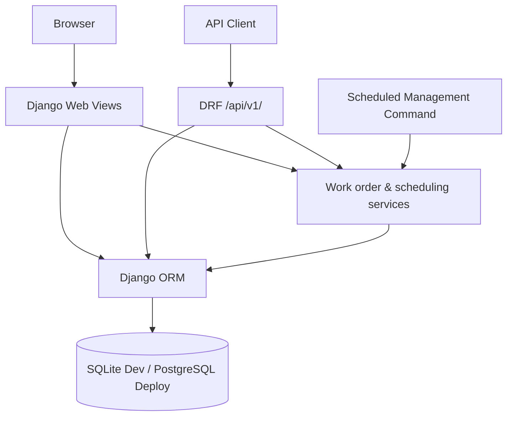

# System Architecture and Design

## System context
AssetOps is a Django monolith with server-rendered HTML pages and an optional REST API sharing one relational database and business rules. It is intended for demonstrations and portfolio evaluation, not certified industrial control.

## Main code modules
- `config/settings.py`: environment-based configuration and database selection.
- `config/urls.py`: admin, authentication, web and API route composition.
- `operations/models.py`: assets, work orders, work order events, maintenance plans and occurrences.
- `operations/views.py`, `maintenance_views.py`: HTML screens.
- `operations/api/`: DRF serializers, permission classes, routers and viewsets.
- `operations/services.py`: guarded status transitions and event creation.
- `operations/maintenance_services.py`: due-date scheduling and generation.
- `operations/management/commands/generate_maintenance.py`: scheduled entry point.
- `operations/test_api.py`, `test_maintenance.py`, `tests.py`: regression tests.

## Core business decisions
1. Server-side role restrictions are necessary for both HTML and API routes.
2. A technician cannot choose someone else's assignment when creating a work order.
3. Order transitions pass through `change_status()` and write audit events.
4. Each (plan, scheduled_for) occurrence is unique at database level.
5. Preventive schedules advance from the prior due date, not execution date.

## Limitations
- Users can see all assets; site/tenant isolation is not implemented.
- No IoT integration, automated email, automatic worker daemon, equipment-hour recurrence or SLA escalation.
- SQLite should run the scheduler from only one process; production concurrent workers should use PostgreSQL with locks and operator-reviewed scheduling cadence.
- Work-order event rows are informational audit history, not immutable tamper-proof records.
