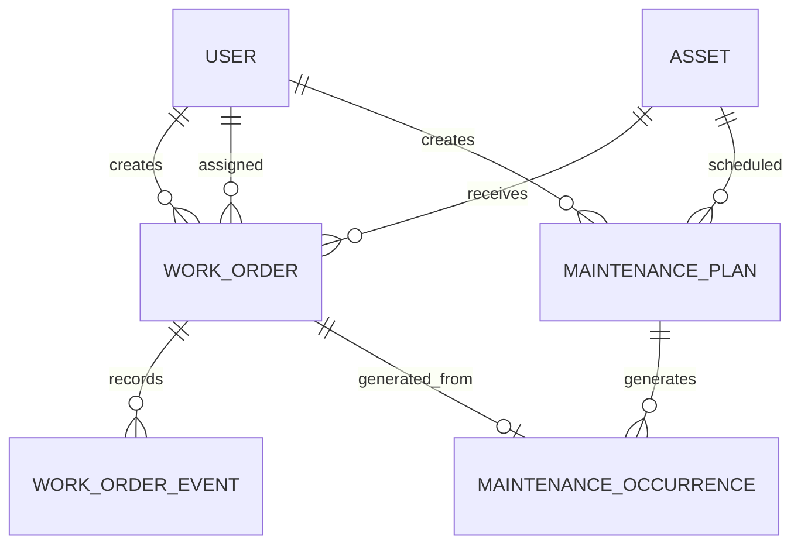

# Database Design and ERD

The database is managed by Django migrations in `operations/migrations/`. Primary keys are numeric Django BigAutoField IDs.

## Entities
**Asset**: code (unique), name, location, description, status, criticality, next_maintenance, timestamps. The legacy `next_maintenance` field is not the authoritative recurring schedule; `MaintenancePlan.next_due` is.

**WorkOrder**: asset (PROTECT), title, description, priority, status, created_by (PROTECT), assigned_to (nullable PROTECT), resolution_notes, timestamps, completed_at. Indexed status and priority.

**WorkOrderEvent**: work_order, actor, prior status, next status, note, timestamp.

**MaintenancePlan**: asset, title, instructions, interval_days (1–3650), next_due, is_active, priority, assigned_to, created_by, timestamps.

**MaintenanceOccurrence**: maintenance plan, scheduled_for, work_order (one-to-one), created_at. Database uniqueness `(plan, scheduled_for)`.

**User and Group**: standard Django authentication and groups: Admin, Supervisor, Technician, Viewer. `is_staff` controls admin-site access separately.

## Data integrity and migration policy
- Foreign keys prevent deletion of referenced assets, users and orders where PROTECT is used.
- Do not edit applied migration files. Add new migrations for changes.
- Back up the production database before migrations and rehearse a restoration.
- Verify `python manage.py makemigrations --check --dry-run` after each schema change.
